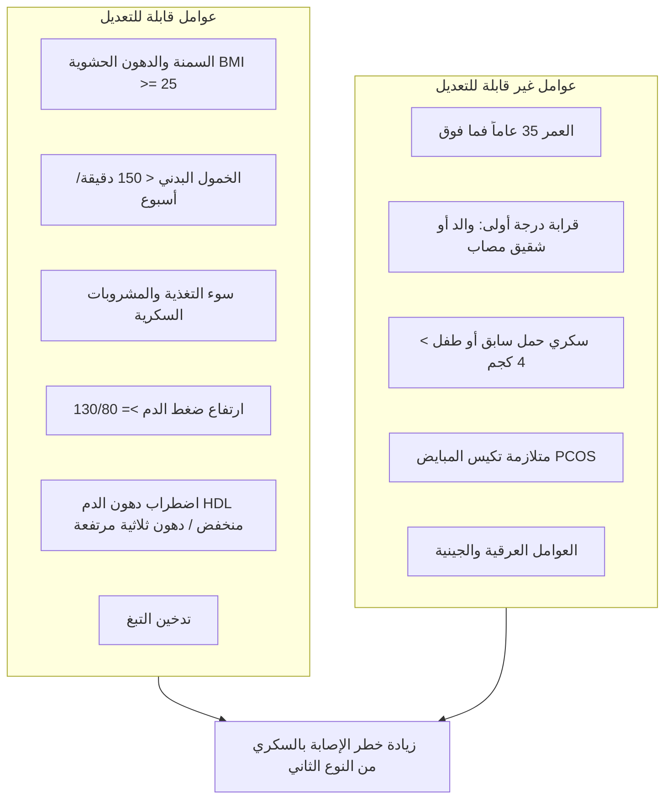

# 02. Symptoms and Risk Factors of Type 2 Diabetes
# أعراض وعوامل الخطر لمرض السكري من النوع الثاني

---

## 1. Clinical Presentation: The Silent and Gradual Onset | الظهور التدريجي والطبيعة الصامتة للمرض
Unlike Type 1 diabetes—which typically develops rapidly within weeks or days—**Type 2 diabetes develops slowly over several years**. Because elevated blood sugar levels rise gradually, the human body often adapts in the initial stages. As a result, **millions of individuals live with prediabetes or Type 2 diabetes without experiencing any noticeable warning signs** until irreversible microvascular or macrovascular complications begin to develop. Regular clinical screening (especially for individuals with one or more risk factors) is critical for early diagnosis.

> **ملاحظة سريرية هامة:**
> يتميز السكري من النوع الثاني بظهوره الصامت والتدريجي على مدار سنوات، ولذلك فإن نسبة كبيرة من المصابين لا يشتكون من أعراض واضحة في البداية. هذا ما يجعل الفحص الدوري للدم الوسيلة الأساسية لاكتشاف المرض قبل حدوث المضاعفات.

* **Verified Sources:**
  * CDC: [Symptoms of Diabetes](https://www.cdc.gov/diabetes/signs-symptoms/index.html)
  * NHS: [Symptoms of Type 2 Diabetes](https://www.nhs.uk/conditions/type-2-diabetes/symptoms/)
  * MedlinePlus: [Type 2 Diabetes Overview](https://medlineplus.gov/diabetestype2.html)
  * NIDDK: [Symptoms & Causes of Type 2 Diabetes](https://www.niddk.nih.gov/health-information/diabetes/overview/what-is-diabetes/type-2-diabetes)

---

## 2. Classic Symptoms of Type 2 Diabetes | الأعراض الكلاسيكية والشائعة

When blood glucose accumulates beyond the renal threshold (typically ~180 mg/dL), glucose spills into the urine, leading to osmotic diuresis and a cascade of clinical manifestations:

| Symptom / العَرَض | Medical Term / المصطلح | Pathophysiological Mechanism / الآلية الحيوية |
| :--- | :--- | :--- |
| **Frequent Urination (كثرة التبول)** | **Polyuria** | High glucose pulls water out of tissues and blood into the kidneys, causing excessive urine production, particularly at night (nocturia). |
| **Excessive Thirst (العطش الشديد المستمر)** | **Polydipsia** | Severe fluid loss through polyuria triggers dehydration signals in the hypothalamus, prompting unquenchable thirst. |
| **Increased Hunger (الجوع الشديد المستمر)** | **Polyphagia** | Although the blood is rich in glucose, insulin resistance prevents cells from absorbing it; cells remain starved for energy and send continuous hunger signals. |
| **Extreme Fatigue (الإرهاق والتعب المستمر)** | **Lethargy / Asthenia** | Inability of muscle and tissue cells to utilize glucose for cellular ATP production leaves the individual chronically drained of energy. |
| **Blurred Vision (تشوش وضبابية الرؤية)** | **Osmotic Lens Swelling** | Elevated glucose shifts fluids into the eye lens, causing swelling and changes in refractive curvature and focal distance. |
| **Slow-Healing Sores / Cuts (بطء التئام الجروح)** | **Impaired Tissue Repair** | Chronic hyperglycemia impairs white blood cell function, reduces microcirculation, and slows collagen synthesis, delaying wound healing. |
| **Tingling, Numbness, or Pain (تنميل وخدر الأطراف)** | **Peripheral Neuropathy** | Sustained high glucose damages delicate nerve fibers in the extremities, starting symmetrically in the toes and feet ("glove and stocking" distribution). |
| **Frequent Infections (الالتهابات المتكررة)** | **Immunosuppression** | Elevated tissue glucose promotes bacterial and fungal (Candida) growth, leading to recurrent skin, urinary tract, and vaginal yeast infections. |
| **Darkened Skin Patches (بقع داكنة مخملية)** | **Acanthosis Nigricans** | High circulating insulin stimulates keratinocytes and fibroblasts, causing hyperpigmented, velvety plaques on the neck, axillae (armpits), and groin. |

* **Verified Sources:**
  * CDC: [Symptoms of Diabetes](https://www.cdc.gov/diabetes/signs-symptoms/index.html)
  * NHS: [Symptoms of Type 2 Diabetes](https://www.nhs.uk/conditions/type-2-diabetes/symptoms/)
  * MedlinePlus Medical Encyclopedia: [Type 2 diabetes](https://medlineplus.gov/ency/article/000313.htm)

---

## 3. Modifiable Risk Factors | عوامل الخطر القابلة للتعديل والتحكم
Modifiable risk factors represent behaviors and health parameters that can be changed, treated, or improved to prevent or delay Type 2 diabetes:

1. **Overweight and Obesity (زيادة الوزن والسمنة):**
   * High Body Mass Index (BMI ≥ 25 kg/m² for general populations, or BMI ≥ 23 kg/m² for Asian populations).
   * **Central / Visceral Adiposity:** Excess abdominal fat surrounding internal organs releases inflammatory cytokines and free fatty acids that directly drive systemic insulin resistance. Waist circumference > 40 inches (102 cm) in men, or > 35 inches (88 cm) in women indicates elevated risk.
2. **Physical Inactivity / Sedentary Behavior (خمول وقلة النشاط البدني):**
   * Being physically active fewer than 3 times per week. Physical activity triggers muscle contractions that absorb glucose independently of insulin.
3. **Unhealthy Dietary Patterns (نمط غذائي غير صحي):**
   * Diets high in refined carbohydrates, sugar-sweetened beverages, ultra-processed foods, saturated and trans fats, and low in dietary fiber and whole vegetables.
4. **Hypertension (ارتفاع ضغط الدم):**
   * Blood pressure measured at **130/80 mmHg or higher**, or undergoing clinical treatment for hypertension.
5. **Dyslipidemia / Abnormal Cholesterol Levels (اضطراب دهون الدم):**
   * Low levels of high-density lipoprotein (HDL "good" cholesterol) **below 35 mg/dL** (0.90 mmol/L).
   * Elevated triglycerides **at or above 250 mg/dL** (2.82 mmol/L).
6. **Cigarette Smoking and Tobacco Use (تدخين التبغ):**
   * Smokers are 30% to 40% more likely to develop Type 2 diabetes than non-smokers. Nicotine impairs insulin receptor signaling and increases visceral fat distribution.

* **Verified Sources:**
  * CDC: [Diabetes Risk Factors](https://www.cdc.gov/diabetes/risk-factors/index.html)
  * NIDDK: [Risk Factors for Type 2 Diabetes](https://www.niddk.nih.gov/health-information/diabetes/overview/risk-factors-type-2-diabetes)
  * WHO: [Diabetes Fact Sheet](https://www.who.int/news-room/fact-sheets/detail/diabetes)

---

## 4. Non-Modifiable Risk Factors | عوامل الخطر غير القابلة للتعديل
Non-modifiable factors are inherent biological and historical characteristics that cannot be changed, but help healthcare providers identify individuals who require proactive and early screening:

1. **Age (العمر):**
   * Being **35 years of age or older** (ADA guidelines recommend screening for all adults starting at age 35, formerly 45). However, rates of T2D are rising dramatically among adolescents and young adults due to shifting obesity rates.
2. **Family History and Genetics (التاريخ العائلي والوراثة):**
   * Having a first-degree biological relative (mother, father, brother, or sister) diagnosed with Type 2 diabetes significantly elevates personal risk due to shared genetic variants and inherited metabolic traits.
3. **History of Gestational Diabetes (تاريخ سكري الحمل):**
   * Developing gestational diabetes during pregnancy, or delivering an infant weighing more than **9 pounds (4.0 kg)** (macrosomia). Women with prior gestational diabetes carry up to a 50% lifetime risk of developing T2D within 5 to 10 years.
4. **Polycystic Ovary Syndrome (PCOS / متلازمة تكيس المبايض):**
   * A hormonal endocrine disorder characterized by hyperandrogenism and anovulation that is strongly intertwined with hyperinsulinemia and cellular insulin resistance.
5. **Race and Ethnicity (العرق والإثنية):**
   * Statistically higher incidence and susceptibility documented in African American, Hispanic / Latino, American Indian / Alaska Native, Asian American, and Native Hawaiian / Pacific Islander populations.
6. **Personal History of Vascular Disease (أمراض القلب والشرايين):**
   * Existing history of coronary artery disease, stroke, or peripheral arterial disease.

* **Verified Sources:**
  * CDC: [Diabetes Risk Factors](https://www.cdc.gov/diabetes/risk-factors/index.html)
  * NIDDK: [Risk Factors for Type 2 Diabetes](https://www.niddk.nih.gov/health-information/diabetes/overview/risk-factors-type-2-diabetes)
  * MedlinePlus: [Type 2 Diabetes Overview](https://medlineplus.gov/diabetestype2.html)
  * American Diabetes Association: [Understanding Type 2 Diabetes](https://diabetes.org/about-diabetes/type-2)

---

## 5. Summary Risk Stratification | جدول تصنيف عوامل الخطر

---

## 6. Official Verification Citations | روابط التوثيق الرسمية المعتمدة
1. **CDC:** [Diabetes Risk Factors](https://www.cdc.gov/diabetes/risk-factors/index.html)
2. **CDC:** [Symptoms of Diabetes](https://www.cdc.gov/diabetes/signs-symptoms/index.html)
3. **NHS:** [Type 2 diabetes symptoms](https://www.nhs.uk/conditions/type-2-diabetes/symptoms/)
4. **MedlinePlus (NIH):** [Type 2 diabetes](https://medlineplus.gov/ency/article/000313.htm)
5. **NIDDK (NIH):** [Risk Factors for Type 2 Diabetes](https://www.niddk.nih.gov/health-information/diabetes/overview/risk-factors-type-2-diabetes)
6. **American Diabetes Association:** [Understanding Type 2](https://diabetes.org/about-diabetes/type-2)
