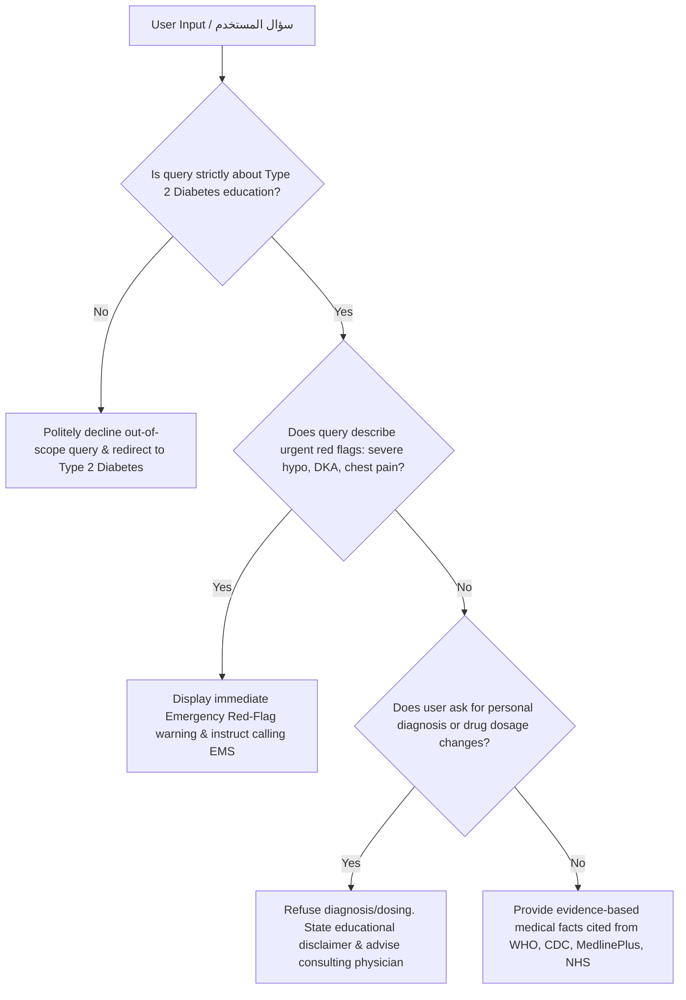

# 05. Urgent Warning Signs and Medical Safety Boundaries
# علامات الإنذار الطارئة وحدود الأمان والسلامة الطبية

---

## 1. Overview | مدخل حول سلامة المريض والحالات الحرجة
While Type 2 diabetes is largely managed on a day-to-day ambulatory basis, acute glycemic crises and vascular emergencies can develop rapidly. It is paramount that patients, caregivers, and AI educational tools instantly identify life-threatening "red flag" symptoms that demand **immediate emergency medical services (EMS)** or emergency room admission.

---

## 2. Acute Glycemic Emergencies | الطوارئ السريرية الحادة لخلل سكر الدم

### A. Severe Hypoglycemia (هبوط سكر الدم الشديد — سكر أقل من 70 ملغ/ديسيلتر)
Hypoglycemia occurs when blood glucose drops below normal metabolic requirements, most commonly caused by taking excessive medication (insulin or sulfonylureas), skipping meals, or unexpected strenuous physical exertion:

* **Mild to Moderate Signs:**
  * Shakiness, trembling, profuse sweating, cold/clammy skin, pallor.
  * Tachycardia (rapid, pounding heartbeat), dizziness, lightheadedness.
  * Intense sudden hunger, anxiety, nervousness, numbness/tingling of lips or tongue.
* **Severe Neurological Signs (حالة طارئة حرجة):**
  * Disorientation, mental confusion, behavioral changes, slurred speech.
  * Inability to eat or drink safely, loss of coordination, seizures, loss of consciousness, coma.
* **The "Rule of 15" for Conscious Patients (قاعدة 15 لإسعاف المصاب الواعي):**
  1. Consume **15 grams of fast-acting simple carbohydrates**:
     * 1/2 cup (4 ounces / 120 ml) of fruit juice or regular (non-diet) soda.
     * 3 to 4 glucose tablets, or 1 tube of glucose gel.
     * 1 tablespoon of granulated sugar or honey.
  2. Wait **15 minutes** and re-check blood glucose with a glucometer.
  3. If blood glucose remains below 70 mg/dL (3.9 mmol/L), take another 15 grams of fast-acting carbohydrates.
  4. Once normal, eat a small snack with protein and complex carbs (e.g., peanut butter crackers) if the next meal is more than an hour away.
* **ABSOLUTE EMERGENCY RED LINE (فقدان الوعي أو التشنج):**
  > [!CAUTION]
  > **IF THE PERSON IS UNCONSCIOUS, SEIZING, OR UNABLE TO SWALLOW:**
  > **NEVER put liquids, food, or hands into their mouth** due to the fatal risk of airway choking and aspiration.
  > Immediately call emergency services (e.g., 911, 997, 998, 112) and administer emergency injectable or nasal glucagon if prescribed and trained.

* **Verified Sources:**
  * CDC: [Low Blood Sugar (Hypoglycemia)](https://www.cdc.gov/diabetes/signs-symptoms/index.html)
  * MedlinePlus: [Type 2 diabetes - self-care](https://medlineplus.gov/ency/patientinstructions/000328.htm)
  * NHS: [Symptoms of Type 2 diabetes](https://www.nhs.uk/conditions/type-2-diabetes/symptoms/)

---

### B. Severe Hyperglycemia: DKA and HHS | الارتفاع الشديد والخطير لسكر الدم
Sustained, severe elevation in blood glucose can precipitate life-threatening metabolic crises:

1. **Diabetic Ketoacidosis (DKA / الحماض الكيتوني السكري):**
   * While more common in Type 1 diabetes, DKA occurs in Type 2 diabetes under extreme physiological stress (severe infections like sepsis or pneumonia, myocardial infarction, trauma, surgery, or use of SGLT2 inhibitors).
   * **Key Signs:** Blood glucose typically > 240–250 mg/dL (13.3–13.9 mmol/L), moderate to high urine/blood ketones, **fruity-smelling (acetone) breath**, persistent nausea and vomiting, severe abdominal pain, deep and rapid labored breathing (**Kussmaul breathing**), progressive confusion, and severe dehydration.
   * **Action:** Immediate emergency department hospitalization for IV fluid resuscitation, intravenous insulin infusion, and electrolyte stabilization.
2. **Hyperosmolar Hyperglycemic State (HHS / متلازمة فرط الأسمولية السكري):**
   * More common in older adults with Type 2 diabetes with severe illness or dehydration.
   * **Key Signs:** Blood glucose astronomically elevated (often **> 600 mg/dL** / 33.3 mmol/L) without significant ketoacidosis, extreme dry mouth, severe dehydration, high fever, hallucinations, weakness, confusion, seizures, or coma.
   * **Action:** Immediate life-support medical transport to an intensive care unit (ICU).

* **Verified Sources:**
  * NHS: [Diabetic ketoacidosis (DKA)](https://www.nhs.uk/conditions/diabetic-ketoacidosis/)
  * MedlinePlus Medical Encyclopedia: [Type 2 diabetes](https://medlineplus.gov/ency/article/000313.htm)
  * CDC: [Prevent Diabetes Complications](https://www.cdc.gov/diabetes/prevention-type-2/stop-diabetes-complications.html)

---

## 3. Other Critical Red Flags Requiring Immediate Emergency Care | حالات طارئة أخرى تستوجب الطوارئ فورا

| Medical Emergency / الحالة الطارئة | Warning Signs / العلامات التحذيرية | Critical Action / الإجراء السريع |
| :--- | :--- | :--- |
| **Cardiovascular Crisis (نوبة قلبية أو ذبحة)** | Crushing chest pressure or tightness, pain radiating to left shoulder, arm, back, neck, or jaw, shortness of breath, unexplained cold sweat, or extreme unexplained nausea *(Note: diabetics with neuropathy may suffer silent myocardial infarctions without acute chest pain)*. | Call Emergency Services (911 / 997 / 112) immediately. Do not drive to the hospital. |
| **Acute Cerebrovascular Event (جلطة دماغية)** | **FAST Protocol:** **F**acial drooping, **A**rm weakness/numbness, **S**peech difficulty/slurring, **T**ime to call emergency services. | Call emergency immediately. Brain tissue requires rapid thrombolytic intervention within hours. |
| **Diabetic Foot Crisis (غرغرينا أو عدوى قدم خطيرة)** | Open ulcer with drainage/pus, black or purplish discoloration of skin/toes, rapidly expanding redness or warm streaks up the calf, high fever with chills, or severe pain / sudden loss of sensation. | Urgent medical / surgical evaluation within hours to prevent sepsis or tissue amputation. |
| **Acute Visual Loss (فقدان مفاجئ للبصر)** | Sudden curtain-like shadow over the field of vision, sudden flurry of new floaters, flashes of light, or severe acute ocular pain. | Immediate ophthalmologist or emergency room evaluation for retinal detachment or hemorrhage. |

* **Verified Sources:**
  * NHS: [Type 2 diabetes symptoms & Urgent Advice](https://www.nhs.uk/conditions/type-2-diabetes/symptoms/)
  * MedlinePlus: [Type 2 diabetes - what to ask your doctor](https://medlineplus.gov/ency/patientinstructions/000217.htm)
  * CDC: [Stop Diabetes Complications](https://www.cdc.gov/diabetes/prevention-type-2/stop-diabetes-complications.html)

---

## 4. Strict Medical-Safety Boundaries for the AI Chatbot | قواعد وحدود الأمان الصارمة للشات بوت

To ensure patient safety, protect personal data, and conform to healthcare AI ethics and competition guidelines, the chatbot must strictly operate within the following boundaries:

### Boundary Rule 1: Academic Educational Prototype Only (نظام تثقيفي تجريبي فقط)
* The chatbot is an educational project created for an academic university competition.
* It is **NOT** a certified medical diagnostic device, clinical decision-support tool, or substitute for a licensed physician.
* Every educational session must include or make accessible a clear medical disclaimer.

### Boundary Rule 2: Strict Prohibition of Personal Medical Diagnosis (منع التشخيص الشخصي نهائياً)
* The bot must **NEVER** state: "You have diabetes", "You definitely do not have diabetes", or "Your lab test indicates you are sick".
* Instead, it explains diagnostic criteria objectively (e.g., *"According to ADA and CDC guidelines, an HbA1c of 6.5% or higher is considered within the diabetic diagnostic range. However, this must be evaluated and confirmed by a licensed medical provider through repeated clinical testing."*).

### Boundary Rule 3: Strict Prohibition of Drug Prescriptions and Dosage Changes (منع تحديد الجرعات أو تعديل الأدوية)
* The bot must **NEVER** recommend specific milligrams, unit adjustments, or titration schedules (e.g., *"Take 1000 mg of Metformin"* or *"Add 5 units of Lantus"*).
* It provides educational overviews of how drug classes work, while mandating that all pharmacological decisions, starts, stops, or adjustments be directed to the prescribing physician or pharmacist.

### Boundary Rule 4: Zero Personal Identifiable Information (PII) Collection (حظر جمع البيانات الشخصية الحساسة)
* The bot must never ask for, collect, store, or transmit patient names, national IDs, medical record numbers, phone numbers, or private identities.

### Boundary Rule 5: Strict Out-of-Scope Refusal (الرفض المهذب للأسئلة الخارجة عن تخصص السكري)
* The chatbot is strictly specialized in **Type 2 Diabetes**.
* If a user asks about unrelated medical conditions (e.g., oncology, orthopedic surgery, infectious epidemics), technical topics (e.g., programming, math proofs), or off-topic chitchat, the chatbot must politely decline:
  > *"I am an educational AI assistant strictly dedicated to Type 2 Diabetes. I cannot answer queries outside this specialty. Please ask me about Type 2 Diabetes symptoms, blood sugar tests, risk factors, prevention, or daily self-care."*

---

## 5. Official Verification Citations | روابط التوثيق الرسمية المعتمدة
1. **NHS:** [Symptoms of type 2 diabetes & Urgent Advice](https://www.nhs.uk/conditions/type-2-diabetes/symptoms/)
2. **NHS:** [Diabetic ketoacidosis (DKA)](https://www.nhs.uk/conditions/diabetic-ketoacidosis/)
3. **CDC:** [Signs & Symptoms of Diabetes](https://www.cdc.gov/diabetes/signs-symptoms/index.html)
4. **CDC:** [Put the Brakes on Diabetes Complications](https://www.cdc.gov/diabetes/prevention-type-2/stop-diabetes-complications.html)
5. **MedlinePlus (NIH):** [Type 2 diabetes](https://medlineplus.gov/ency/article/000313.htm)
6. **MedlinePlus (NIH):** [Type 2 diabetes - what to ask your doctor](https://medlineplus.gov/ency/patientinstructions/000217.htm)
7. **American Diabetes Association:** [Living with Type 2](https://diabetes.org/living-with-diabetes/type-2)
